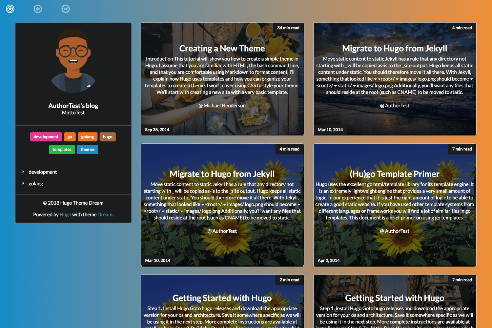
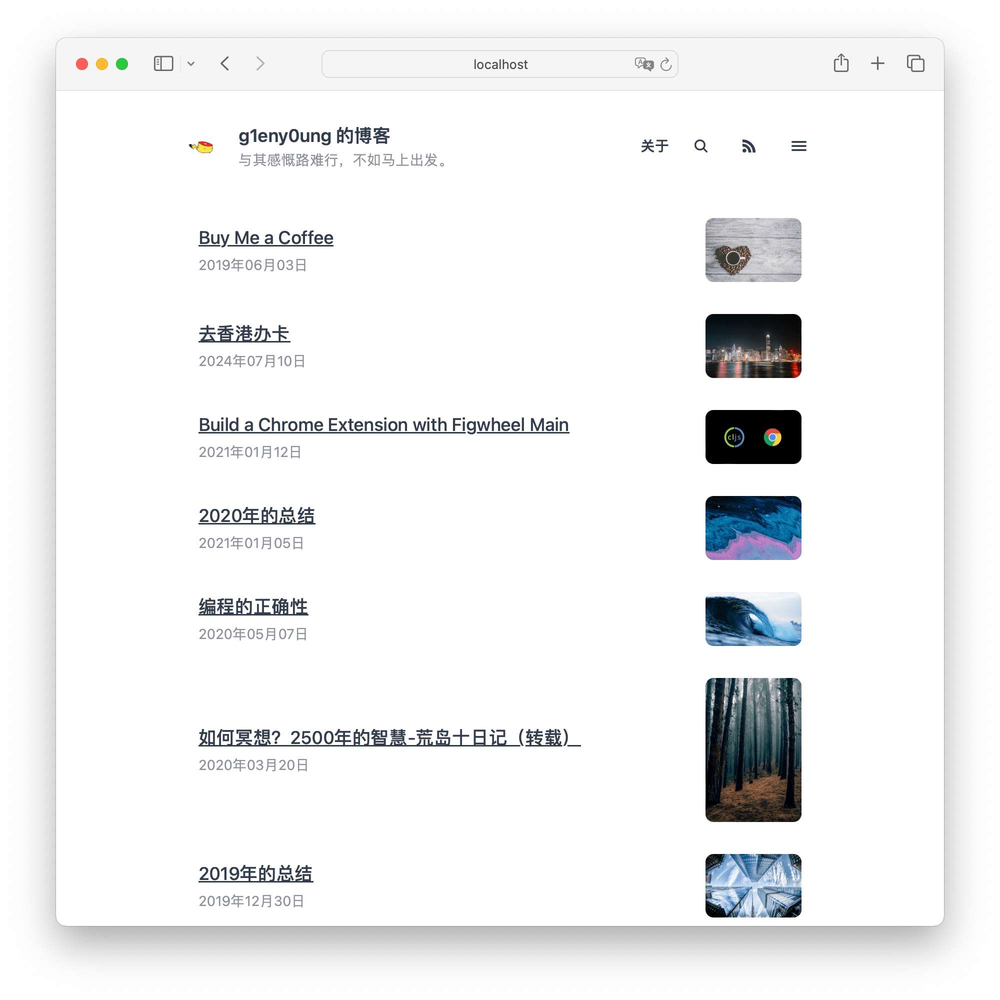

# 🌱 hugo-theme-dream


> [!IMPORTANT]
> This branch contains Dream v3.
>
> If you use v2.x, see the [v2 branch](https://github.com/g1eny0ung/hugo-theme-dream/tree/v2) and its [documentation](https://hugo-theme-dream-docs-v2.netlify.app/).

- [About Dream](#about-dream)
- [Get started](#get-started)
- [Examples](#examples)
- [Develop locally](#develop-locally)
- [Publish your site](#publish-your-site)

## About Dream

Dream is a [Hugo](https://gohugo.io/) theme. I build it for [my blog](https://g1en.site).

Dream displays posts in a masonry layout and has a flippable About page.
It supports light and dark mode out of the box.



For a single-column layout focused on reading and writing, use [Zen mode](https://hugo-theme-dream.g1en.site/zen-mode).



## Get started

Use Hugo Extended. Follow the [Quick Start](https://hugo-theme-dream.g1en.site/) to install Dream in your site and create your first post.

Set `theme = "dream"` in your site's `hugo.toml` when you install the theme under `themes/dream`.
Use [hugo.example.toml](hugo.example.toml) as the configuration reference.
The [documentation](https://hugo-theme-dream.g1en.site/) covers About pages, search, comments, customization, and other options.

Dream includes prebuilt CSS and JavaScript. You need Node.js and pnpm only to rebuild theme assets or work on the documentation site.

## Examples

- [My blog](https://g1en.site) and its [source code](https://github.com/g1eny0ung/blog)
- [A demo of Zen mode](https://g1en-site-zen-mode-preview.netlify.app/)

## Develop locally

Use Node.js 24 and pnpm. The root theme package and the `docs/` package have separate dependencies and lockfiles.
Reuse your existing shared dependency caches.

### Build theme assets

Run these commands from the repository root:

```sh
pnpm install --frozen-lockfile
pnpm run build
```

Edit `src/input.css` for styles and `src/js/` for browser behavior.
The build writes tracked output to `assets/css/output.css` and `assets/js/`.
Include the generated files with source changes.
Template changes that affect Tailwind or daisyUI classes also need a CSS rebuild.

To rebuild only one asset type, use `pnpm run css` or `pnpm run js`.
To rebuild assets as you edit, run:

```sh
pnpm run watch
```

### Preview the theme

Use a separate Hugo site with content and configure it to load this checkout as its theme.
This repository is not a standalone blog, and the documentation site does not preview Hugo templates.
See the [Quick Start](https://hugo-theme-dream.g1en.site/) for site setup.

From the Hugo site directory, run:

```sh
hugo server -D
```

The `-D` flag includes draft posts. Keep the asset watcher running when you edit theme styles or JavaScript.

### Run the documentation site

Use the pnpm version declared in `docs/package.json`.
From the repository root, run:

```sh
cd docs
pnpm install --frozen-lockfile
pnpm run dev
```

Edit user guides in `docs/content/`.
Run `pnpm run build` from `docs/` to build the static documentation site in `docs/out/`.

## Publish your site

See [Hosting & Deployment](https://gohugo.io/hosting-and-deployment/).

## License

Hugo Theme Dream is licensed under the [MIT License](LICENSE).

Author: [g1eny0ung](https://github.com/g1eny0ung).
